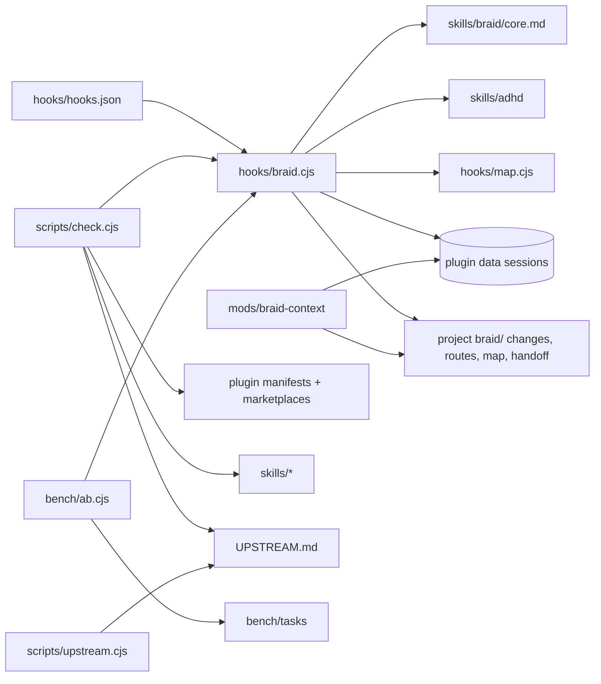

<!-- braid:map sha=c9d702b date=2026-10-22 -->
# Repo map

braid: a clean-code harness plugin (an always-on core plus workflow skills) for Claude Code, Codex, ZCode and Pi,
and the separate Claude Code-only `braid-context` mod. For plugin maintainers.

Commands and conventions: see `AGENTS.md`. Behavior: `braid/specs/`. Terms: `braid/GLOSSARY.md`. Decisions: `braid/adr/`.

## Entry points

- `extensions/braid.js`: what Pi loads instead of `hooks.json`. It spawns `node hooks/braid.cjs session|prompt` on `session_start` and `input`, and sets the `braid` system prompt section in `before_agent_start`.
- `hooks/hooks.json`: what Claude Code, Codex and ZCode load. It runs `hooks/braid.cjs session|prompt|subagent` on SessionStart, UserPromptSubmit and SubagentStart.
- `skills/<name>/SKILL.md`: each skill, invoked as `/braid:<name>` (`$braid` in Codex and ZCode, `/skill:<name>` in Pi).
- `mods/braid-context/hooks/register.tsx`: the mod's `register`, which Claude Code itself loads through the mod's `hooks/hooks.json` (`modules`).
- `scripts/check.cjs`: the repo check that CI runs (`.github/workflows/check.yml`).
- `bench/ab.cjs`: the A/B benchmark (braid vs ponytail vs none).
- `scripts/upstream.cjs`: read-only upstream drift report for the SHAs in `UPSTREAM.md`.

## Modules

| Path | Job | Key files |
|---|---|---|
| `hooks/` | the only runtime: injects the core, project state and generated map, and tracks the level per session | `braid.cjs`, `map.cjs`, `hooks.json` |
| `extensions/` | Pi's adapter: runs `hooks/braid.cjs` and puts its output in Pi's system prompt | `braid.js` |
| `skills/braid/` | the always-on rules and the level switch | `core.md` (injected text), `SKILL.md` |
| `skills/spec/` | propose → apply → archive over `braid/changes/` | `propose.md`, `apply.md`, `archive.md`, `discover.md` |
| `skills/standards/` | writes a project's AGENTS.md and optional delegation | `template.md`, `stacks.md`, `delegation.md` |
| `skills/{review,audit,debt}/` | ponytail-based review skills | `SKILL.md` |
| `skills/{map,wayfind,handoff,xreview,design,skill,help}/` | braid's own clean-room skills | `SKILL.md`; `skill/evals.md` (evals and trigger tuning) |
| `skills/retro/` | clean-room: recurring tool failures from every harness's transcripts → AGENTS.md rules, then a router to vendor tools | `SKILL.md`, `retro.cjs` (the extractor) |
| `skills/{grilling,grill-me,grill-with-docs,domain-modeling,adhd,humanizer,security-audit,systematic-debugging}/` | vendored verbatim, pinned in `UPSTREAM.md` | `LICENSE`, `SKILL.md` |
| `skills/*/agents/openai.yaml` | Codex policy; marks user-only skills | per skill |
| `.claude-plugin/`, `.codex-plugin/`, `.zcode-plugin/` | one manifest per harness, one shared version | `plugin.json` |
| `.claude-plugin/marketplace.json` | Claude marketplace: `braid` plus the mod's entry (the mod's manifest and version live here) | |
| `.agents/plugins/marketplace.json` | Codex marketplace, which installs from GitHub `main` | |
| `mods/braid-context/` | Claude Code band: context, cache countdown, spend, braid level, git branch and change | `hooks/register.tsx`, `hooks/register.test.ts`, `types/index.d.ts` |
| `scripts/` | repo check and upstream drift | `check.cjs`, `upstream.cjs` |
| `bench/` | A/B harness, tasks and published results | `ab.cjs`, `tasks/<task>/{task.json,files,solution,check.*}`, `results/<run>/report.md` |
| `braid/` | braid's own specs, changes, ADRs, glossary and routes | `specs/*/spec.md`, `changes/archive/`, `adr/`, `routes/v1.md` |
| root docs | provenance, licenses, release checklist | `UPSTREAM.md`, `THIRD-PARTY-NOTICES`, `TESTING.md`, `CONTRIBUTING.md`, `CHANGELOG.md` |

## Key flows

### Session start (all harnesses)

1. `hooks/braid.cjs` reads stdin, with a 1 s fallback timer, then calls `run`, which calls `onSession`.
2. `load(sid)` reads the session state `{mode, drift, adhd}` from `$CLAUDE_PLUGIN_DATA|ZCODE_PLUGIN_DATA|PLUGIN_DATA/sessions/<sid>.json` (falls back to tmpdir).
3. `core(mode)` takes `skills/braid/core.md`, strips its frontmatter and keeps only the active level's table row.
4. `pointers(cwd)` adds active and queued changes (`braid/changes` or `openspec/changes`, counted from `tasks.md` checkboxes), open routes, and the map and handoff staleness read from their `sha=` headers.
5. `generatedMap(cwd)` runs `hooks/map.cjs` in a child process (3 s kill; it reads nothing through a link and drops paths with spaces or quotes), but only when `braid/map.md` is absent and cwd is in a git repo.
6. Prints the result as `hookSpecificOutput.additionalContext`.

### Level switch

1. `/braid:braid lite` → `onPrompt` normalizes the prompt (also Codex/ZCode `[$braid](path)` links) and matches the command.
2. `save(sid, st)` writes the state file; the reply is a one-line `BRAID LEVEL` row, or the full core when coming back from `off`.
3. `subagent` events re-inject `core(mode)` unless the session is off.

### Mod band refresh (Claude Code only)

1. `register.tsx` `classic.SessionStart` / `classic.UserPromptSubmit` → `remember` runs after `next(e)`, so braid's own hook has saved the level first.
2. `braidState` finds the enabled `braid@<marketplace>` plugin and reads `<config>/plugins/data/braid-<marketplace>/sessions/<sid>.json`.
   It also tries `braid-inline` first and `braid-synced` last, when those folders exist: `--plugin-dir` (`braid@inline`) runs in place of an installed copy, the synced copy (`braid@synced`) only when no installed copy is enabled, and only the copy that runs writes the file.
3. `refresh` also reads the branch with `git branch --show-current` (`$.process.run`).
4. `turn.step` records cache use; `turn.complete` takes the TTL from the transcript, past `$.fs.read`'s 4 MiB from its last MiB via `tail -c` or, on Windows, PowerShell (`$.process.run`); `session.start` ticks `$.clock.every(1000)` until the cache deadline; each calls `$.ui.invalidate('ui.render')`.

### Repo check

`scripts/check.cjs` checks, in order: the manifests and the shared version, the paths they reference, `hooks.json` wiring, skill frontmatter and user-only marking,
the help table, a hook smoke test (a copy under a `"type": "module"` package), the always-on budget against `PONYTAIL_ALWAYS_ON`, UPSTREAM/licenses/notices, and per-skill size.

### Bench run

`bench/ab.cjs` `once` copies `tasks/<t>/files` into a fresh git repo outside home, then runs `claude` or `codex` with one arm (or, under `--fake`, applies `solution/`).
It then runs `check`, `dry` and the blind `complete` judge, and `report` writes `bench/results/<date>-<agent>-<model>/`.

## Gotchas

- Creating this file switches off the generated map (`hooks/map.cjs`) in this repo's sessions; the session hook then points to `braid/map.md` and its staleness instead.
- Pi's state lives in `<Pi agent folder>/braid/sessions/`: the extension passes it as `PLUGIN_DATA` and drops `CLAUDE_PLUGIN_DATA`/`ZCODE_PLUGIN_DATA` in any case, which the hook would prefer. The extension re-runs the session hook after any prompt reply starting `BRAID`, so that prefix is an interface: every state change, ADHD toggles included, must confirm with a `BRAID` line.
- `hooks/braid.cjs` must never throw or block. The stdin fallback timer stays ref'd on purpose, because Windows can swallow stdin's `end`.
- Scripts are `.cjs` so that a parent `"type": "module"` can't break them; `check.cjs` tests exactly that.
- `skills/braid/core.md`, `hooks/map.cjs` and `skills/{review,audit,debt}` are based on ponytail. Edit them only by renames or whole added blocks (ADR 0012), which is why `core.md` keeps ponytail's frontmatter.
- "Active change" counting lives in two places: `braid.cjs` `pointers` and `register.tsx` `activeChange`. Change both together.
- The mod reads braid's state file by path (`plugins/data/braid-<marketplace>/sessions/`, or `braid-inline` and `braid-synced`), so moving that path in `braid.cjs` breaks the band silently.
- The mod's version lives in its marketplace entry, not in `plugin.json`, and is separate from braid's version (ADR 0013).
- `PONYTAIL_ALWAYS_ON` in `check.cjs` is a hand-measured constant; re-measure it on every ponytail sync.
- `bench/tasks/` is outside both linters (`biome.json`, `.markdownlint-cli2.jsonc` globs) so fixtures stay as written; its `files/` are deliberately flawed inputs.
- `bench/results/` is committed output; most of `git ls-files` lives there.
- `/braid:help` must list every skill; `check.cjs` fails otherwise.
- `skills/retro/retro.cjs` parses four transcript formats as they were in 2026-10 (Claude Code JSONL, Codex rollouts, ZCode's SQLite store, Pi JSONL); `check.cjs` builds a fake home with all four, and the ZCode part runs only where `node:sqlite` exists (the Node 22 CI job).

## Diagram

